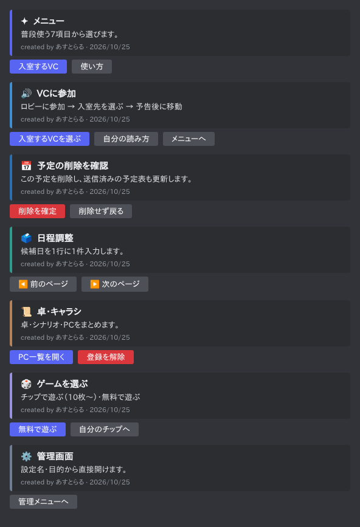
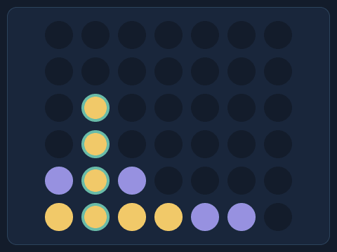

# 見た目のルール（v6.1〜）

Botのカード・ボタン・ゲーム画像を、機能ごとに見分けやすく、全画面で同じ規則になるよう揃えています。

## カード（埋め込み）

見出しの先頭の記号と左端の色で、どの機能の画面かが分かります。

| 機能 | 記号 | 色 | 対象 |
|---|---|---|---|
| メニュー | ✦ | `#5865F2` | `/menu` のホーム・使い方・画像工房 |
| 入室・読み上げ | 🔊 | `#3D8FD1` | VC入室、待機・カウントダウン、バックアップ読み上げ、自分の読み方 |
| 予定表 | 📅 | `#2B6FB1` | 予定表・共有予定表・取り込み・整理（カレンダー画像の「今日」と同じ青） |
| 日程調整 | 🗳️ | `#2C9C8F` | 伝助の作成・共有 |
| 卓・キャラシ | 📜 | `#B5835A` | 卓セット・キャラシパネル・控え |
| ゲーム | 🎲（各ゲームは 🃏 🎰 ✊ 🟡 🪙 🐔） | `#9791E0` | ゲーム選択・各ゲーム・チップ |
| 管理 | ⚙️ | `#6F7D93` | `/admin`、診断・更新・再起動・起動設定・バナー・投稿タグ |

- 成功・注意・失敗の画面は機能の色ではなく、緑 `#29856D`・黄 `#B77920`・赤 `#C94F61` で表示します。
- 予定表名など、利用者が付けた名前の絵文字は消しません。

## ボタン

| 種類 | 見た目 | 例 |
|---|---|---|
| その画面で進める操作 | 青（Primary）。1画面に1つが目安 | 入室するVCを選ぶ、変更を保存 |
| 移動・戻る・取り消し | 灰（Secondary） | メニューへ、変更せず戻る、入室をキャンセル |
| 消える・止まる操作 | 赤（Danger） | 予定を削除…、削除を確定、登録を解除、読み上げを停止 |
| 前後のページ・項目 | 灰＋◀️／▶️ | 前のページ、次の5件、前の月 |
| 外部ページ | リンク | 回答ページを開く |

赤くするのは、削除・消去・停止・中断と、登録やバナーの解除です。「〜せず戻る」「一時停止」、検索・条件・選択・固定・絞り込みの解除は赤くしません。

## ゲーム画像

ブラックジャック・カジノ・4目並べは、同じ紺色の背景・角丸パネル・枠線で描画します。4目並べはあなたが金、Botが紫、揃った4つは緑の輪で示します。

カレンダー画像は読みやすさを優先した明るい配色のまま、見出しの青だけをカードの予定表の色と合わせています。

## 開発者向け

- カードは `src/ui.js` の `themed(feature, icon)` から作ります。各画面ファイルの先頭で `const {payload}=themed('schedule');` のように機能を決めます。
- ボタンの規則は `polishComponents()` にまとめ、`payload()` と全ての操作応答（`src/index.js` の `polishResponses`）で適用します。新しいボタンは文言を上の規則に合わせれば自動で揃います。
- 規則のテストは `test/design-theme.test.js`。

## ロール返信（v6.4〜）

通常のチャットダイスとサイゼロールは、`roll-ui.js`でゲーム共通の🎲・紫色のカードへまとめます。1式の結果またはサイゼの番号は見出し、複数式は1枚の本文で式ごとに結果と内訳を並べます。数値は等幅表示と区切り、10個ごとの改行。最大200個の出目をすべて残し、補正は符号付きで表示します。ボタン・画像添付は増やしません。

サイゼの料理名は前置!のある依頼だけ番号の下に表示します。固定の0と末尾10→0を内訳に明記。料理名付きはフッターに参照表の版・現在の提供が未確認であることを載せ、見出しを参照表へのリンクにします。料理名なしでは参照結果・参照リンクを出しません。

埋め込み権限がない場合は文字で全内訳を返します。カード送信失敗後に自動で文字を再送する処理はありません。[見本と再生成方法](DICE.md#表示の見本と再生成)。見本は実送信データをHTML化したモックで、Discord実機画面ではありません。

## 情報の優先順位（v6.12〜）

概要は結果・現在の状態・次の操作から並べます。診断の詳細は既存の選択欄で分野別に切り替え、VC一覧は5件ずつにします。任意の表示切り替えでAPI照会や保存を始めません。

ゲームの無料/チップ区分と、チップ残高の増減内訳はネイティブの2つのinlineフィールドでまとめます。PCでは並列、スマートフォンではDiscord側の表示幅に応じて折り返します。読み上げの待機分消去は、確認内容を冒頭・注意色で表示します。新しいボタンを並べず、既存の操作と最大3ボタン/行を維持します。

[改善前後の実送信データによるHTML見本](previews/readability-v6_12.html)。架空データのモックで、Discord実機とは区別します。

## 運用画面（v6.13〜）

結果は概要、長い注意点や全対象は選択欄で開く配置にします。脆弱性診断の一覧は1ページ3件、勧告の全対象/修正版候補は5項目ずつ。絞り込み・詳細・保存を1つの選択欄にまとめ、画面全体は3行・1行3ボタン以内です。版の比較と起動設定はネイティブのinlineフィールドで並べます。更新の変更内容リンクはカード本文に置き、更新ボタンは1行2つ以内にします。

表示を変えても通信・保存・更新を実行せず、未確認と失敗を安全・成功の色にしません。同じ対象の有効な容量見積もりが最低空き条件を下回れば、先頭と注意色で案内します。[PC/スマホ幅の比較モック](previews/operations-v6_13.html)。

## 一般機能と卓管理（v6.14〜）

予定の日時・日程調整の次の操作・ゲームの手番などを本文の先頭にし、関連情報はネイティブのフィールドへ分けます。卓セット/起動設定/画像比較のように並べて比べる項目はinline、長い説明や日程は全幅です。ネイティブの各フィールド1024文字とカード全体の6000文字を確認します。

PC一覧と卓管理は関連操作を選択欄へまとめ、4目並べは7つのボタンを1つの列選択欄へ変更します。盤面の番号を保持し、置ける列と空きマス数だけを表示。操作数の削減で対象や公開範囲の検証を省かず、別パネル/条件の古いPC操作欄は拒否します。[8画面の比較モック](previews/members-v6_14.html)。

## ガイドと測定結果（v6.15〜）

ガイドは手順と準備/終了、困ったときの案内を分けます。ダイスの多い記法も高度な式とサイゼ用の案内へ分け、共通制限は残します。読み上げやダイスの現在の有効状態は各表示でも確認できます。

音声測定は要点と停止理由を概要へ、全時間とCPUを詳細へ分けます。状態更新の位置は変えず、不要な無効中断ボタンを未測定画面から減らします。中断の確認は最上部へ。遅い合成・中断・停止は注意色にし、表示だけで測定や中断を起こしません。チップの入力エラーは注意色・修正案内を出し、同じ相手の下書きを保持して直せるようにします。[比較モック](previews/recovery-v6_15.html)。

## エラー後の案内（v6.16〜）

ゲーム・チップの予期しない内部エラーは固定の状態確認案内へ置き換え、入力ミス等の既知の案内は残します。生のSDK/OSメッセージを説明や見出しに使いません。エラーからの再表示も現在の権限を確認し、表示自体が失敗すれば画像や残高を伴わない短いカードへ戻します。

チップ調整はエラー時に入力や調整案を保持していることを案内し、2ボタン以内の復帰導線を出します。確認後に残高/履歴が変わった場合は注意色・先頭の説明・保存の無効化を揃え、別の値へ自動適用しません。理由は全文をMarkdownエスケープして表示します。[比較モック](previews/game-recovery-v6_16.html)。
