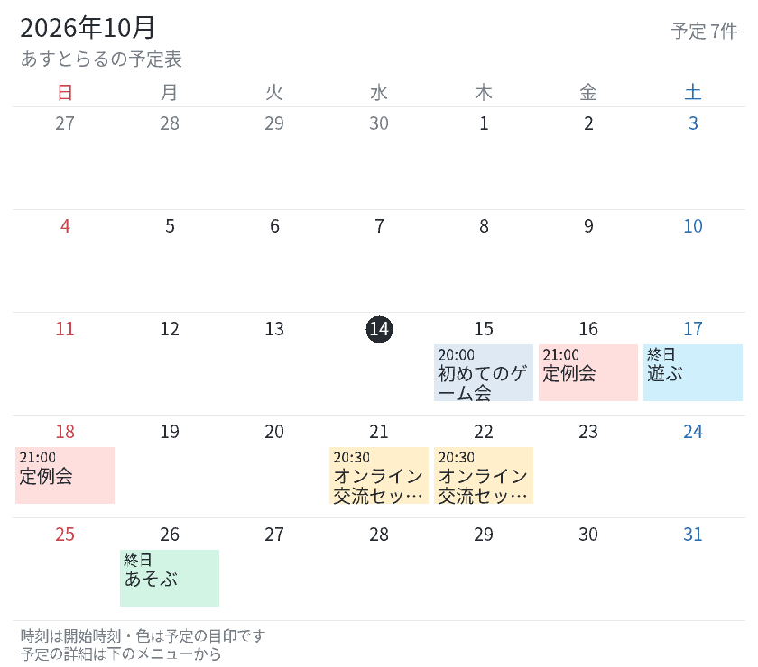
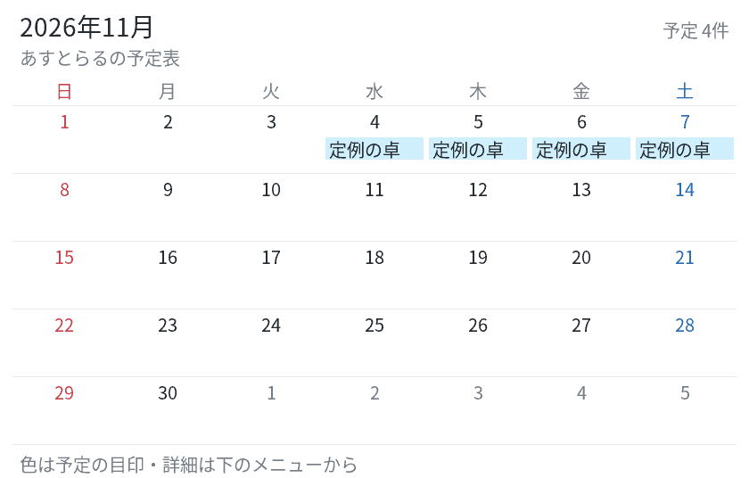

# v4.4 カレンダーの更新

余白・予定名の省略・時刻が見えない点を見直しました。予定の少ない月では行の高さを縮め、空きに応じて名前を2行まで、開始時刻を小さな行で表示します。予定の多い月は従来の3段の帯と残り件数を優先します。

以下は架空データの表示例です。実際のサーバーの予定を取得・変更したものではありません。

4件の単日予定の例は高さ866pxから536pxになり、件数や日付は維持します。同じ名前が連続していても別々の予定は自動で結合しません。1つの連続した帯にする場合は、管理者が複数日の終日予定として登録してください。

[予定が多い月の例](previews/calendar-v4_4.png)では、3段の帯と残り件数を表示します。長い名前の全文・終了時刻・場所は、一覧や詳細から確認できます。

## 日付を入力せず選ぶ

`/menu → 予定表 → 共有予定表 → 日付から探す` で、予定のある日を件数・名前と一緒に選べます。管理者の予定表でも同じ操作ができます。

「すべての日を表示」で予定がない日も選べます。最大25日ずつ表示し、月・ページを切り替えられます。「今日を開く」「日付を入力」も使えます。

「選ばず戻る」は元の検索・表示範囲・ページを維持します。日付を選んだ場合はその日の予定へ移り、管理者は「この日に予定を追加」から追加できます。

## 予定の色を決める（管理者）

`/admin → 予定表 → 予定の詳細 → 予定の色を選ぶ` で、青・緑・赤・紫・黄・グレーを選びます。「自動」に戻すこともできます。

色は目印です。自動では同じ予定名に同じ色を使い、管理者が用途に合わせて変更できます。画像の予定帯と、文字の一覧・詳細へ反映し、既存の共有投稿も更新します。閲覧者は色を変更できません。

名前・日時を編集しても選んだ色を保持し、複製・繰り返し追加にも引き継ぎます。ICSの色はアプリごとの対応が異なるため、取り出すファイルには含めず、取り込む新規予定は自動の色になります。

## 詳細を続けて見る・1件だけ保存する

詳細の「前の予定／次の予定」で、現在の月・日・週・30日分・検索結果の中を順に移動できます。一覧へ戻ると、開いている予定のページを表示します。

「この予定だけ保存（ICS）」は、その1件だけを `astral-event.ics` に保存します。複数日の予定も元の期間のまま含め、対応するカレンダーアプリへ取り込めます。画面を開き直しても自動でファイルを再送しません。

## 更新と互換性

`/admin → バージョン管理 → 更新を確認` からv4.4.0へ手動更新してください。v4.3以降なら容量の目安も表示されます。追加ENV・依存パッケージ・手作業のデータ移行は不要です。

既存の予定・共有先・月/週/30日表示・検索・ICS取り込み・権限確認は維持します。保存形式はversion 1のまま、任意の色だけを追加します。検証は模擬Discord・一時ファイルと生成画像で実施し、実機の操作は手動更新後に確認してください。
