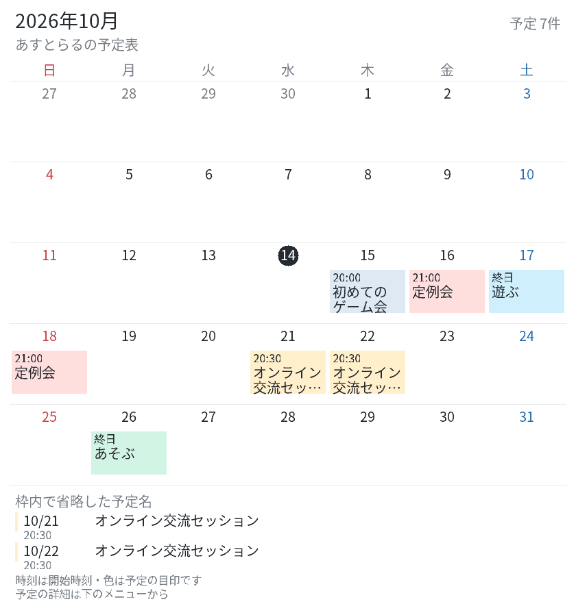

# v4.4.1 長い予定名を画像で読む

月間表示で切れてしまう予定名だけ、画像下部に全文を補足します。日付・開始時刻・予定帯と同じ色を併記し、別日の同名予定を見分けられます。日付の丸印と帯の間にも余白を加えました。少し小さい文字で1行に収まる名前は1行にし、2行の名前も行の長さを揃えて読みやすくします。

補足は最大8件です。続きがあれば残り件数を表示し、下のメニューで確認できます。同じ予定が週をまたぐ場合は補足を重複させません。別の予定を自動結合することはありません。

補足には画像内で実際に表示した帯で省略する名前だけを載せます。同日に4件以上ある場合の隠れた予定や、終了時刻・場所などは引き続き一覧・詳細から確認してください。

`/admin → バージョン管理 → 更新を確認 → 更新` で手動反映します。既存の予定を保持し、依存関係・ENVの変更はありません。共有投稿は既存の更新操作、個人の画面は開き直しで新しい表示を確認できます。
